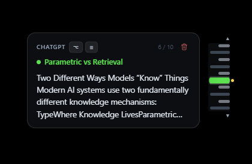
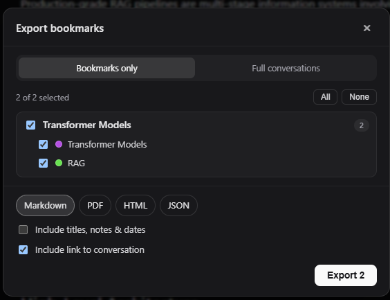

# ChatMap

ChatMap is a Chrome extension for finding things in long ChatGPT conversations. It adds a minimap beside the chat so you can jump back to a message without scrolling through everything in between.

## Implementation

I built it with **TypeScript and React**, using Vite to bundle the extension. Hovering over a marker shows a preview of the message. Clicking it takes you there. You can also bookmark messages and move between them with keyboard shortcuts.

You can export the whole conversation or just your bookmarks. The extension popup is where you change the keyboard shortcuts.

## Links

- [Source code](https://github.com/jacobkobr/chatmap)
- [Chrome Web Store](https://chromewebstore.google.com/detail/lmkifloejhppjonoaejlppbghbhcclmd)
