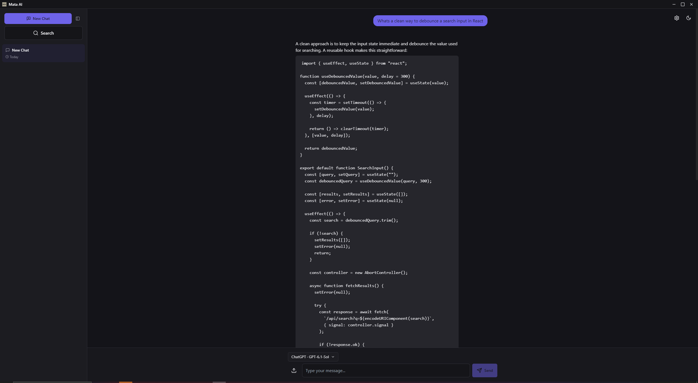
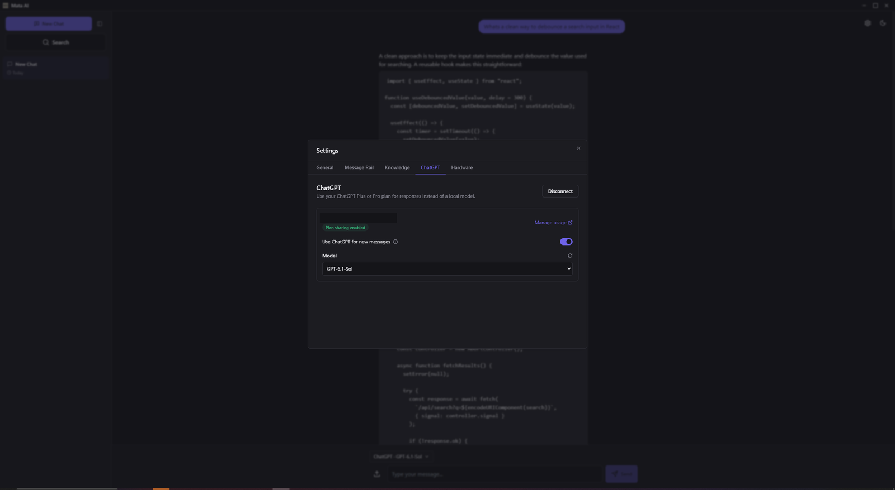
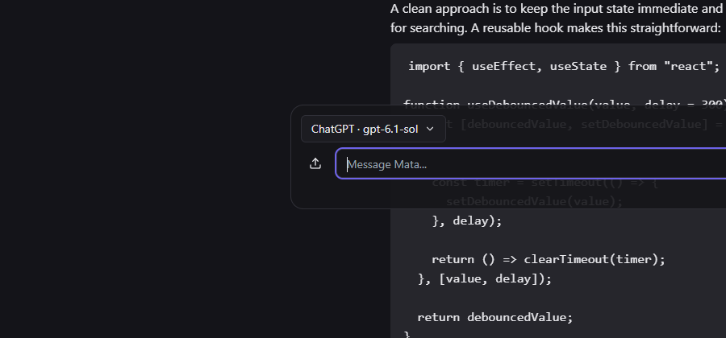

# Mata

I built Mata because I wanted a desktop UI for the Ollama models I run at home. It also supports signing in with ChatGPT. The app uses Electron, Next.js, and Zustand, and saves chat history as JSON files on disk.

## Choosing a model

You can choose Ollama, ChatGPT, or auto mode for each message. Auto checks whether Ollama is running and the selected model is installed before falling back to ChatGPT. Image attachments stay local because the ChatGPT route used by the app doesn't accept them.

The app includes model downloads, chat search, bookmarks, and a minimap for navigating long conversations. A global shortcut opens a small always-on-top window for quick questions.

## Shared provider core

I moved the backend integrations into `mata-provider-core` so they wouldn't be tied to React state. Both providers implement the same methods for checking availability, listing models, and streaming responses.

The package has no React or Electron dependency. Ollama uses fetch directly, while ChatGPT goes through a bridge supplied by the host app. That keeps the desktop session handling outside the shared code.

## Links

- [App source code](https://github.com/jacobkobr/Mata)
- [Provider core source code](https://github.com/jacobkobr/mata-provider-core)
